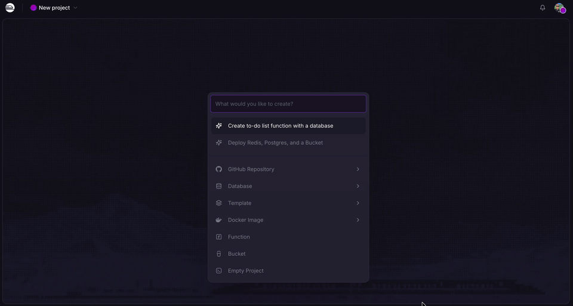
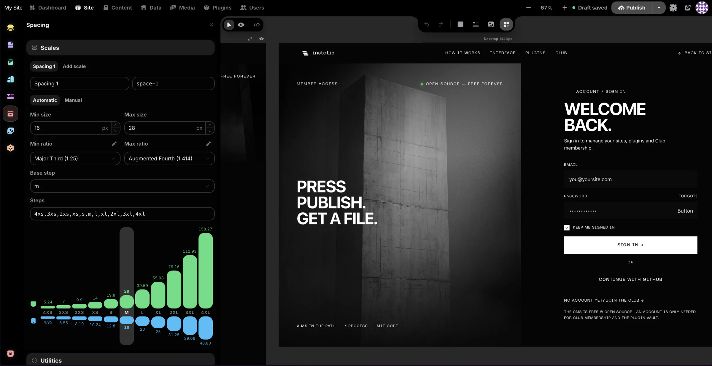
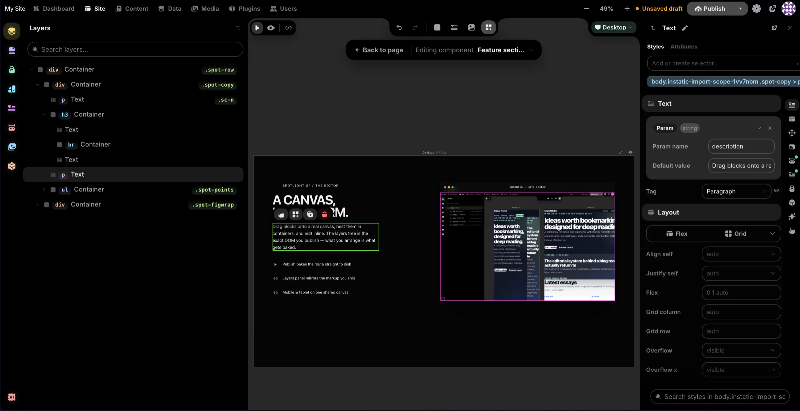
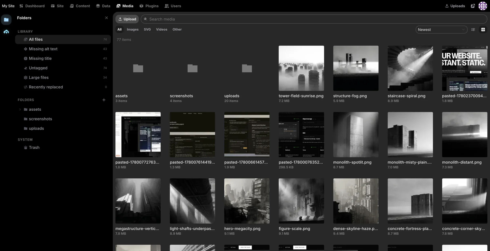
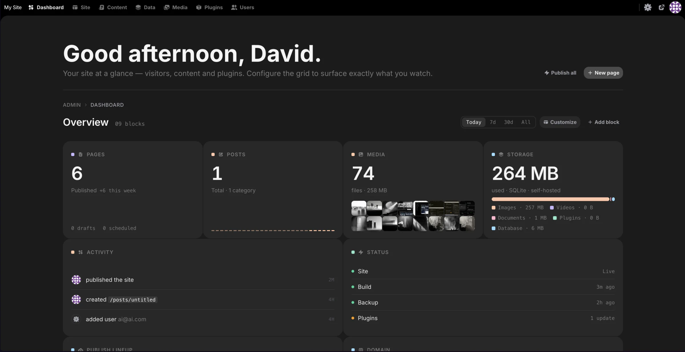

<div align="center">

# Instatic

**Own your site. Love building it.**

A self-hosted CMS where the visual editor, content engine, and publisher all live in one Bun server — and the pages it ships are clean enough to read in view-source.

<p>
  <a href="https://trendshift.io/repositories/66792?utm_source=repository-badge&utm_medium=badge&utm_campaign=badge-repository-66792" target="_blank" rel="noopener noreferrer">
    
  </a>
</p>

[](https://github.com/corebunch/instatic/releases)
[](https://github.com/corebunch/instatic/stargazers)
[](LICENSE)
[](https://bun.sh)
[](https://www.typescriptlang.org/)

[One-Click Deploy](#deploy-in-one-click) · [Quick Start](#quick-start) · [Docs](docs/README.md) · [Plugins](docs/features/plugin-system.md) · [Roadmap](#early-on-purpose)

<br>

<a href="https://www.youtube.com/watch?v=zyjCF_TaLlg">
  
</a>

*Watch the introductory video about Instatic on YouTube.*

</div>

<br>

A modern website usually means assembling a stack: a headless CMS, a framework, a host, a form service, an analytics vendor, an image CDN — each with its own bill, dashboard, and 2 a.m. outage. Instatic is the opposite bet. One Bun server holds the whole thing — the canvas editor, the content engine, media, auth, forms, plugins, and the publisher — and you run it wherever you like, backed by SQLite or Postgres.

What comes out the other end is the part most builders quietly compromise on: plain semantic HTML and compact CSS, with none of the editor's machinery left behind in the page. No framework runtime, no builder attributes, no div soup. The site loads like a static file because, most of the time, it is one.

**MIT. Self-hosted. Yours.**

<br>

## Deploy in one click

Railway is the fastest way to get Instatic live. Pick a template, hit the button, wait about two minutes. That's it. It generates the secret keys, attaches the storage volume, and sets up the health checks on its own. You never open a terminal.

<div align="center">



*One minute to live. Unedited.*

</div>

<br>

| Provider | Database | Best for | Deploy |
|---|---|---|---|
| **Railway** · *Recommended* | SQLite | A single site — blog, portfolio, small business | [Deploy →](https://railway.com/deploy/instatic-cms-sqlite?referralCode=Zm9bVJ&utm_medium=integration&utm_source=template&utm_campaign=generic) |
| **Railway** | Postgres | Multiple authors, managed backups, room to grow | [Deploy →](https://railway.com/deploy/instatic-cms-postgres?referralCode=Zm9bVJ&utm_medium=integration&utm_source=template&utm_campaign=generic) |
| **Render** | SQLite or Postgres | Teams that prefer Render services, disks, and managed Postgres | [Guide →](docs/deployment/render.md) |
| **Docker / VPS** | SQLite or Postgres | Bring-your-own server, Caddy TLS, custom backup policy | [Guide →](docs/deployment/vps.md) |

SQLite is the right default for most sites. Reach for Postgres when you've got a team of authors or want managed database backups.

### Updating is just a redeploy

When a new Instatic version is available, update by redeploying the latest image. Your database and uploads stay on the attached storage, so the app container can be replaced without rebuilding the site from scratch.

Prefer your own hardware? Instatic is a single Docker image:

```sh
INSTATIC_IMAGE=ghcr.io/corebunch/instatic:latest docker compose -f compose.prod.yml -f compose.sqlite.yml up -d
```

Full guides for VPS, Postgres, HTTPS with Caddy, Render, and backups are in [docs/deployment](docs/deployment/README.md).

<br>

## One tool, the whole life of a site

Most tools do one job and hand you off for the rest. You design in one place, build in another, keep content somewhere else, then bolt analytics on from a fourth. Instatic does all of it. Here's what's actually in the box.

### 🎨 Design



The editor is a real canvas, not a form with a preview pane stapled to it. You put several breakpoint frames side by side and edit them together. Change the desktop and the mobile frame reacts in the same view. When you'd rather work on the real thing, flip to live mode and edit a single full-size page in place.

The part nobody else has: **[Core Framework](https://coreframework.com) is built in.** It's the design-token engine thousands of WordPress pros already use every day, and here it's a core system, not a plugin you install and pray over.

- **Color tokens that generate their own shade scale.** Define one brand color, get the full set of tuned tints and shades automatically.
- **Type scales that are fluid and mathematical.** One ramp that scales with the viewport, instead of forty hand-picked font sizes you have to keep in sync.
- **Spacing scales** so every page and every breakpoint keeps the same rhythm.
- **A utility-class generator** that emits locked, generated classes into one small `framework.css`. No bloat, no duplicate rules, nothing you didn't ask for.

Your whole design system lives as data. Change one token and every page that uses it updates.

**An inspector that answers in the same frame.** Every value in the Properties panel is something you click or drag, not something you have to know the CSS syntax for: a 3×3 grid for object and background position, unit selects that can hold `auto`, a square Auto chip in the spacing editor, a visible border from the first click. Typing a number, sliding, or dragging left and right on any numeric field previews on the canvas instantly and commits once when you let go — one undo entry per drag, and the canvas never glides after the cursor, because edit mode neutralises the site's own CSS transitions. On the canvas itself: corner dots that round the element (Alt for a single corner, following the Radius row's "separately" mode), a ratio lock the resize handles honour (Shift flips it per drag), and an eye in the Spacing section that shows every margin and padding at once. The editor's fields, search bars and grouped buttons share one surface ramp, so the left sidebar, the inspector and every floating popout look the same.

### 🧱 Build



- **Modules** are the building blocks: containers, text, images, buttons, video, lists, links, SVG, forms. Drag them onto the canvas and nest them however you want.
- **Visual Components** are reusable pieces with typed parameters and named slots. A parameter can be a string, number, boolean, color, image, URL, rich text, an enum, or a whole slot of content. Edit the component once and every instance on the site updates. Components that would reference themselves are blocked before they happen, so nothing eats its own tail.
- **Templates** handle the shared chrome. One layout for the whole site, separate layouts per post type, and a real 404 page you design yourself. Content flows into an outlet, so a header and footer get written once and wrap everything.
- **Loops** repeat a layout over a collection: your posts, your pages, your media, or anything a plugin exposes as a source. Give a loop a couple of variants and it alternates between them as it goes. Good for post lists, product grids, galleries.
- **Forms that belong to your CMS.** Build a form out of semantic fields and the submissions land in your own data tables. Instatic can read the fields you placed and create the matching table for you. No third-party form service, no embed, no monthly fee for a contact form.
- **An AI agent that actually edits the page.** Describe what you want and it builds it on the canvas as real, editable nodes, not a screenshot or a wall of code. It writes semantic HTML for structure and CSS for style, through the same import pipeline you use when you paste markup. A 40-tool Site scope builds pages and components; a 15-tool Content scope edits entries. Bring your own model: Claude, OpenAI, OpenRouter, or local Ollama. Your key, your model, your bill.
- **Imports that hold up.** Paste raw HTML and get editable nodes. Or drop a whole static site — HTML, CSS, images, fonts — and Super Import turns it into pages, style rules, design tokens, and media. Every conflict is shown to you before anything is written, and the entire import is a single undo.

### 🗂 Manage



- **One content model under everything.** Pages, posts, components, custom collections, and any structured table you invent all live in the same store: `data_tables` and `data_rows`. There's no special-cased "pages" table hiding in a corner. Schemas, raw rows, imports, exports, and form submissions all sit in one consistent place.
- **A Data workspace where you design your own collections.** At `/admin/data` you create custom post types and custom data tables with their own fields, then work the rows in a spreadsheet-style grid: search, sort, filter, bulk publish, bulk export. Custom post types come with a real editorial workflow — draft, scheduled, published — and version history on the published copy. Plain data tables are simple grids you can point at anything: the submissions from a form, a product catalog, a lightweight CRM, a list of testimonials. And every table you build is a content source a loop can render. Define a "Team" table once, loop it onto your about page, done.
- **A content workspace for writing.** A focused surface for posts and collections, plus live mode so authors edit inside the real design of the site instead of a gray textarea.
- **A media workspace that works like a file manager.** Folders and smart folders, bulk operations, usage tracking so you know where a file is actually used, replacement workflows, and pluggable storage adapters when you outgrow local disk.
- **Access control that's real, not decorative.** Roles built from 38 capabilities, token-based sessions, TOTP two-factor with secrets encrypted at rest, account lockout with backoff after repeated failures, and step-up prompts before the dangerous stuff like deleting a user or signing out every device.
- **⌘K for everything.** A fuzzy command palette over the whole admin. Jump anywhere, do anything, without touching the mouse.
- **Drafts stay drafts.** Unpublished edits never leak to a visitor. What you didn't publish, they don't see.

### 📊 Analyze



- **A dashboard you arrange yourself.** A 12-column grid of tile widgets you can drag, resize, and rearrange. Add the ones you care about in customize mode, and the layout saves per user. Plugins can ship their own widgets into the same grid.
- **An audit log that doesn't forget.** Every meaningful admin action writes a row: logins, content changes, role edits, plugin lifecycle. It's append-only, so it's a real record of who did what and when, not something anyone can quietly rewrite.
- **Form data that's yours.** Submissions sit in your own tables. Query them, export them, build on them. No vendor in the middle.

The analytics surface today is intentionally operational: dashboard status, audit history, and owned form data instead of third-party visitor tracking.

### 🔌 Extend

Every CMS has plugins. The difference here is where backend plugin code runs.

An Instatic plugin is a zip package with a manifest. Its server entrypoint runs in a per-plugin worker that hosts a **QuickJS-WASM sandbox**: no filesystem, no environment variables, no network at all unless the site owner grants it, one host at a time. Editor extensions and app-kind admin pages are different: they run in the admin window and require the explicit `editor.code` permission before install.

Through the SDK, a plugin can add:

- HTTP routes and its own admin pages
- Storage and scheduled background jobs
- Loop data sources, so your content loops can pull from anywhere
- Canvas modules — new blocks that show up in the editor
- Media storage adapters and frontend assets
- Lifecycle hooks across install, activation, and beyond

Start with the [plugin system docs](docs/features/plugin-system.md) and the [template plugin](examples/plugins/template/README.md).

<br>

## Fast because there's almost nothing to load

A published Instatic page is mostly just a file sitting on disk. No framework to boot, no hydration step, no database round-trip on the common path. The browser pulls down semantic HTML and compact CSS bundles, and it's done. There's barely anything between the visitor and the content, so the pages feel instant.

That speed isn't a setting you tune. It falls out of how publishing works, in three layers you never have to think about:

- **Static pages are baked straight to disk when you publish** and swapped in atomically. Visitors are served a file, not a render.
- **Routes that genuinely change** hit a versioned in-memory cache. Publishing bumps the version, so old entries miss lazily and nobody sees a stale page.
- **The few truly per-visitor parts** are detected automatically and lazy-loaded by a runtime that weighs about 1.1 kB. Smaller than this paragraph.

What comes out the other end is plain HTML and compact CSS, all the way down. Nothing from the editor rides along: no React on your public pages, no editor runtime, no framework in the markup. And because it's just HTML and CSS, nothing holds your site hostage — you can read it, host it anywhere, or take it and leave. Full design: [the publisher](docs/features/publisher.md).

<br>

## Quick start

You need [Bun](https://bun.sh). Nothing else. The default dev setup runs on SQLite, so there are no extra services to stand up.

```sh
git clone https://github.com/corebunch/instatic.git
cd instatic
bun install
bun run dev
```

Open `http://localhost:5173`. The first visit walks you through creating your site and your owner account.

Want to see it the way it actually ships? `bun run start` builds the admin and serves it from the Bun server at `http://localhost:3001/admin`.

> **Backups, in one sentence:** back up the database (a Postgres dump or the SQLite file) and the uploads folder, and you've backed up the whole site — [details](docs/deployment/backup-restore.md).

<br>

## Who's behind this

We're the team behind **[Motion.page](https://motion.page)** and **[Core Framework](https://coreframework.com)** — tools that thousands of people use to build websites for a living, mostly in the WordPress world.

We spent years making other platforms more bearable. At some point the obvious question wouldn't go away: what if the thing underneath was just right to begin with? No legacy to work around, no markup we're not allowed to touch, no business model that depends on keeping your site where we can see it.

So we built Instatic. And we brought Core Framework along, wired in as a core system, so the color shades, type scales, spacing, and utility classes our users already rely on are part of the product — not an add-on you install and hope for the best.

<br>

## Early, on purpose

Here's the honest part: this is version 0.0.x.

Everything above — the canvas, Core Framework, the universal content model, the sandboxed plugins, the AI agent, forms, loops, templates, media, MFA, the audit log, one-click deploy, the clean publisher — is the starting line, not the finish. What's coming:

- **Real analytics.** First-party and privacy-respecting, to round out the Analyze pillar.
- **A bigger module and plugin ecosystem.** More first-party blocks, more SDK surface, more examples to copy from.
- **A sharper AI agent.** More tools, deeper awareness of your actual site.
- **Everything tighter.** We're pre-1.0 on purpose. It's the cheapest time to throw out bad ideas and keep the architecture clean.

APIs and workflows can still shift before 1.0. If that makes you nervous, wait for 1.0 — no hard feelings. If you'd rather help shape what site ownership looks like for the next twenty years, now's the good seat.

<br>

## For developers

One Bun server. A React admin built with Vite. A publisher that emits pages you'd be happy to have written yourself.

| | |
|---|---|
| **Runtime** | Bun, for both server and tooling |
| **Language** | TypeScript everywhere |
| **Admin app** | React 19 (React Compiler on), Vite, Zustand + Mutative, CodeMirror, dnd-kit |
| **Server** | `Bun.serve` with a hand-written router |
| **Database** | SQLite or Postgres — one `DbClient` interface, picked by `DATABASE_URL` |
| **Validation** | TypeBox at every untyped boundary; schemas are the source of truth |
| **Plugins** | QuickJS-WASM backend sandbox, owner-granted permissions, explicit `editor.code` for admin-window code |
| **AI** | Provider-agnostic drivers over raw HTTP/SSE, no vendor SDKs |
| **Output** | Semantic HTML, compact CSS, baked static files plus auto-detected dynamic holes |

The codebase is opinionated, and the opinions are enforced in code. Architectural rules live in `src/__tests__/architecture/` as actual tests, so the structure that keeps the output clean can't quietly rot.

```sh
bun run build   # tsc -b && vite build
bun test
bun run lint
```

Dig in: [docs index](docs/README.md) · [architecture](docs/architecture.md) · [editor](docs/editor.md) · [server](docs/server.md) · [publisher](docs/features/publisher.md) · [plugin system](docs/features/plugin-system.md)

<br>

## What this fork adds

This fork tracks [CoreBunch/Instatic](https://github.com/CoreBunch/Instatic) and adds editor work on top of it — mostly on the two surfaces you touch all day: the colour/fill pipeline and the inspector.

### Shipped in `main`

**Colour, as a proper editor.** A saturation/brightness surface, hue and alpha tracks, HEX/RGB/HSL with an opacity field, the native eyedropper where the browser has one, a searchable design-token list, and **New Style** — name a colour and it becomes a framework token, bound to the field you were editing, without a detour through the Colors panel. The colour surface and both tracks are `role="slider"` and steppable from the keyboard. It lives in a floating panel you can drag out of the way; it dodges the editor's sidebars, and only one is ever open at a time.

**Gradients as a first-class fill.** Linear, radial and conic, with an editable stop strip: click to add a stop (its colour interpolated at that position), drag to move, double-click to remove. Behind the swatch, one control owns both `background-color` and `background-image` — switching between solid and gradient swaps them in a single patch, so it's one undo step, and a `url(...)` background is left alone rather than clobbered. Gradients are reachable from the background swatch and from Background image → Custom; they stay off `color` and `border-color`, where CSS can't hold them anyway.

**Gradient handles on the element itself.** When the selected element's active style target carries a gradient, the canvas draws the gradient line across it. Drag a stop to slide it, drag the end cap to rotate (Shift snaps to 15°). Radial gets stops but no rotation; conic gets both. The geometry is the real CSS gradient line — `|w·sinθ| + |h·cosθ|`, not the box diagonal — and it's unit-tested.

Both the picker and the gizmo are **optimistic**: local state moves every frame, while the store/CRDT/canvas commit is throttled to ~15 Hz with a guaranteed trailing emit, and the floating panel drags by writing CSS custom properties straight to the DOM instead of re-rendering.

**Visual Component variants.** A `classBindings` channel on the tree lets an enum parameter on a component map each of its values to a CSS class — the styling counterpart to `propBindings`, which can only ever change props, never appearance. Pick "Primary / Ghost / Danger" on an instance and the matching class is appended after the node's own classes, so the variant wins the cascade and the publisher keeps its CSS. A **Variants** section in the Properties panel wires every enum param to a class or "No class", and five new agent tools (`site_create_component`, `site_insert_component`, `site_set_component_params`, `site_bind_component_prop`, `site_bind_component_variant`) give the AI the same reach.

**~23,700 icons, nine packs.** Pixelarticons, Feather, Font Awesome 6, Material, Bootstrap, Ionicons 5, Remix, Tabler, and Simple Icons brands. Only the registry is imported eagerly; each pack loads on demand. The picker emits inline SVG markup into a `base.svg` node, so it still passes through the publisher's sanitize boundary and none of the icon-import architecture gates are bent.

**Non-destructive media crop with a focus area.** Crop and focus are stored on the asset as 0–1 rectangles against the *original* upload (`crop_json`, `focus_json`; two additive migrations). Cropping reads the pristine bytes, so the original is never rewritten and clearing the crop restores the full frame. Every derivative — dimensions, BlurHash, the whole variant ladder — is regenerated from the cropped frame, and variant filenames carry a crop hash so a re-crop writes new paths instead of overwriting files already baked into published HTML. Moving only the focus point skips re-encoding entirely. `base.image` gained an `objectFit` control (`default` / `cover` / `contain`), which is what gives the focus point something to do; the publisher and the canvas map focus through the crop with the same helper.

**Unsplash import.** Optional — set `UNSPLASH_ACCESS_KEY` and it appears; leave it unset and it doesn't exist. Browse the editorial feed or search, from the Media toolbar, the media picker, or an existing asset's viewer to replace its file. The client sends a photo ID, never a URL: the server re-fetches through Unsplash's own download endpoint, pulls the bytes through the same SSRF-guarded downloader and the same sniffing, size ceiling, and variant pipeline as a hand-dragged file. Attribution links are rendered on every tile and written into the imported asset's caption (pinned by tests), and the download ping fires on import.

**Fixes worth calling out.**

- Replacing a media file now **keeps its public URL**. It used to mint a fresh storage path, turning every page tree, style rule and published page that referenced the old one into a 404. The new bytes reuse the previous path when the extension matches; a `?v=<epoch>` stamp handles cache-busting, and the canvas swaps its asset cache in place instead of clearing it and waiting, so a replaced image updates without a reload.
- `DbClient.close()` — an open SQLite handle made the file undeletable on Windows (`EBUSY`) and broke temp-database teardown. Adding it turned a large block of server tests green on Windows with zero regressions.

### On branches, not yet merged

**`feat/inspector-panel-redesign`** — a rebuild of the inspector around nine scoped sections: Position, Size, Layout, Spacing, Styles, Typography, Effects, Transforms, Interaction. The old "Advanced" disclosures are gone — on six of the sections a searchable `+` menu adds a property, rows appear only once set, and each added row carries its own remove dash. Border and Shadows moved into popouts, Radius gained a per-corner mode, Effects became a real section with four effects translated both ways between CSS and their parameters, and the class bar now shows which breakpoint edits are landing on. New primitives: `FloatingPanel` (portalled, draggable, with drill-in sub-views instead of stacked panels), `StepGroup`, `SwatchRow`, `UnitField`, `ScopeGroup`, `PositionControl`, and `Input` grew a hover stepper and drag-to-scrub. Spacing is a nested margin/padding box you scrub band by band, with a hatched overlay drawn on the canvas in zoom-stable screen space and a value-editor popout that offers the framework's spacing tokens; Position gets the same box for inset, plus pins that freeze an axis. On the canvas: **radius handles** that follow the inspector's all-vs-per-corner scope (Alt flips it per drag), a **ratio-locked resize** where the lock is one piece of state shared by the panel row and the handle (Shift flips it), and free-move dragging for absolutely-positioned elements that rewrites whichever inset sides the element actually stores — mirroring `right`/`bottom` rather than stranding them — with ±4 screen-px snap guides to sibling and parent edges. Two surface ramps (`--card-*` / `--panel-*`) resolved by a `data-surface` stamp mean the sidebar, the inspector, and every popout finally share one field appearance. It also fixed the "border does nothing" bug at its root: a unitless `border-top-width: 400` was invalid CSS, so width fields moved to `UnitField` and `border*Width` joined the length properties. 342 files, 20 new test files, including a prototype-parity gate that asserts the control scale against the original HTML mock. Still open: Blend, the Transforms rotate/scale/origin rows, and a handful of author decisions (opacity scale, hover-effect popout, accessibility section).

**Nothing in the editor waits for a commit.** This is the optimisation thread running through both the shipped colour work and the inspector branch:

- Dragging a number field, a canvas handle, or a colour track moves the element on the frame the pointer moves. The gesture writes a preview — inline style inside the iframe, or through a `previewInlineStyles` / `previewClassStyles` channel in the store — and the document commit lands once, on release. One drag is one undo entry.
- High-frequency input is coalesced, not amplified: a 1000 Hz mouse produces one apply per animation frame; the colour picker's store/CRDT emit is trailing-throttled to 64 ms with a flush on unmount; a canvas gesture echoes into the inspector's fields on the same 64 ms budget while the element itself follows every frame.
- Every scrub takes pointer capture past a 4 px threshold, so the drag survives crossing the canvas iframe instead of losing moves and handing back one accumulated jump on re-entry.
- Design frames neutralise the page's own `transition`s on `[data-node-id]` and descendants, so an edit lands this frame rather than gliding after the cursor. The live frame and all animations are untouched.
- The cost is measured, not hidden: the Site editor body chunk's budget moved from 780 KB to 880 KB for the redesign's weight, with the reason written into the gate itself.


**UI primitives, split into reviewable branches:**

- `refactor/control-height-scale` — one height scale (24 / 30 / 36 px) shared by `Button`, `Input`, `Select` and `SegmentedControl`, replacing per-module hardcoded pixels that made a button and an input in the same row impossible to align.
- `feat/number-field-primitive` — a `NumberField` with a hover-revealed stepper, horizontal drag-to-scrub (4px per step, Shift ×10, pointer-captured so it survives leaving the control), and unit passthrough: `auto`, `1fr` and `var(--space-m)` pass through untouched, a typed unit wins over the field's own, and typing commits on Enter or blur rather than per keystroke.
- `feat/button-group-primitive` — a `ButtonGroup` fused bar replacing two hand-rolled copies of the same chip switcher in the Properties panel.

<br>

## Thanks

Instatic's interface uses [Pixelarticons](https://pixelarticons.com/) by Gerrit Halfmann. Thanks to Gerrit for a genuinely distinctive icon set, and for kindly letting us use it in an open-source project.

## License

MIT. See [LICENSE](LICENSE). No tiers, no open-core asterisks, no "contact sales."
